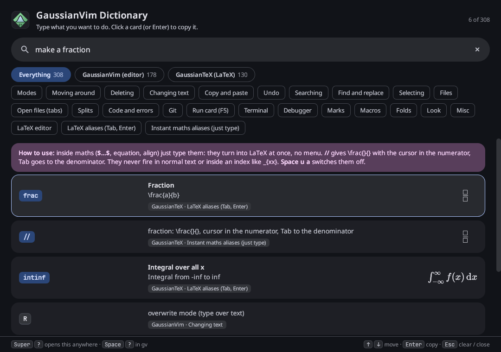
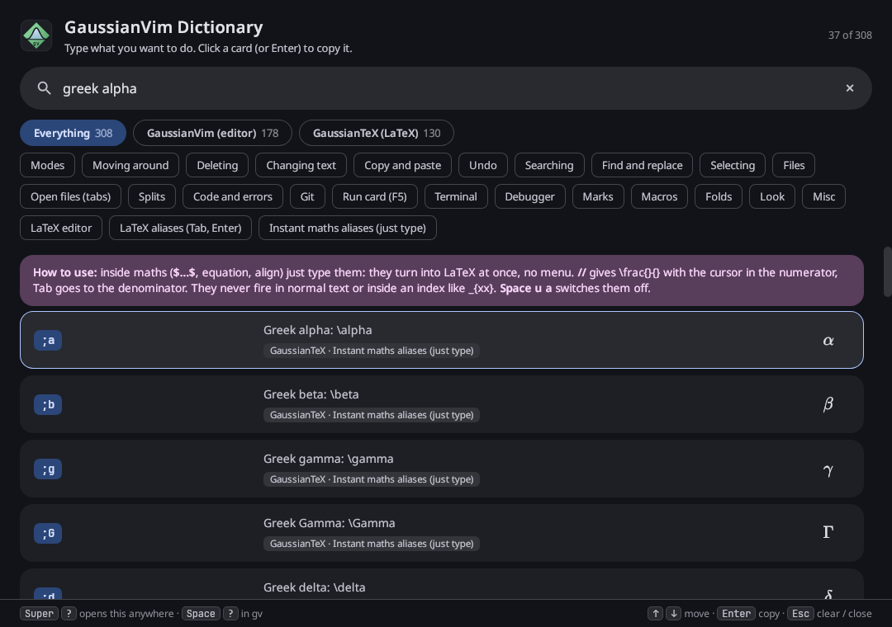
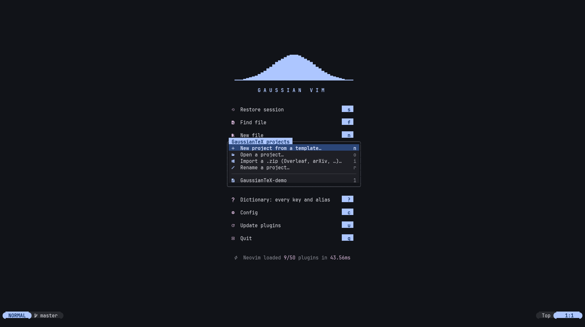
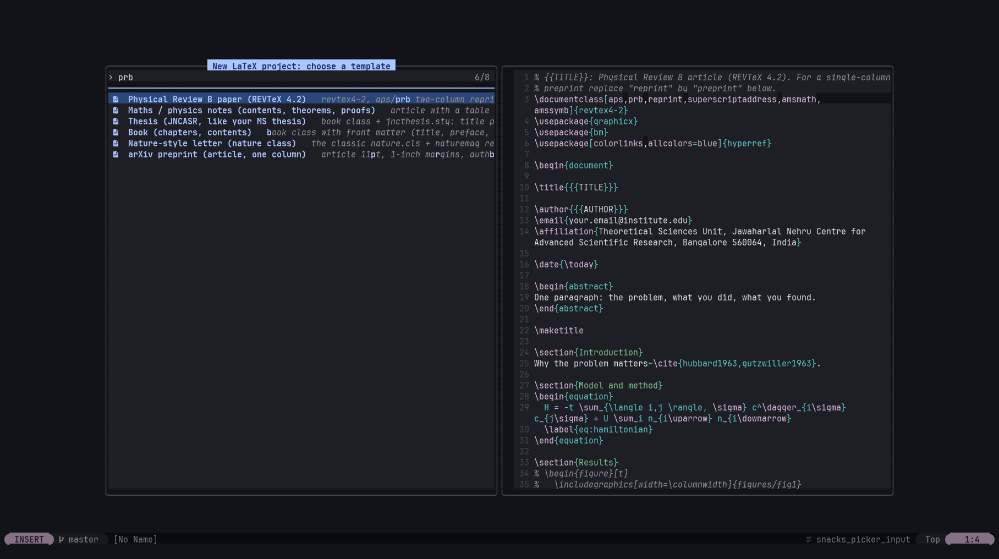
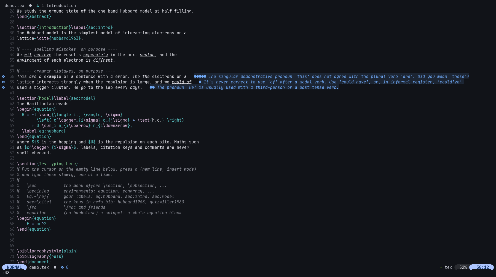
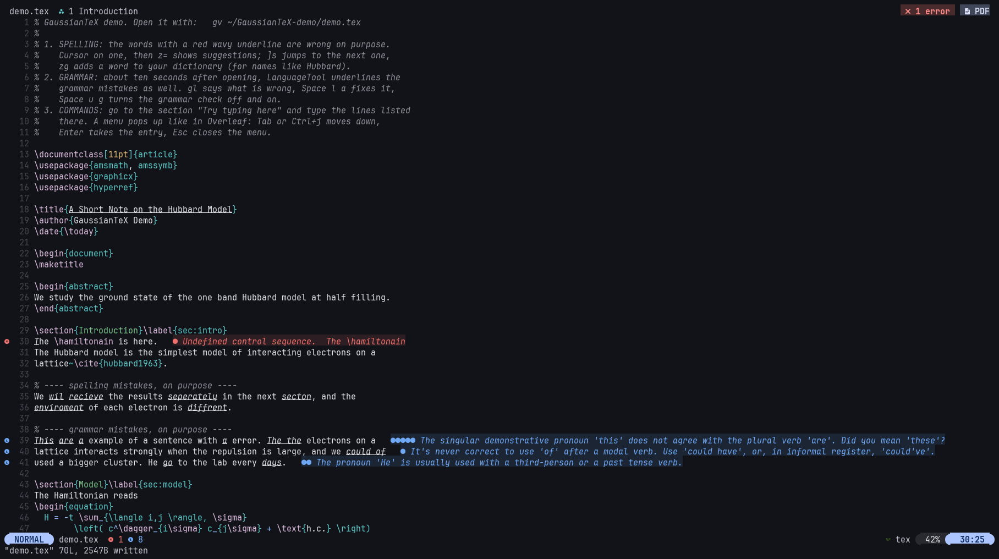
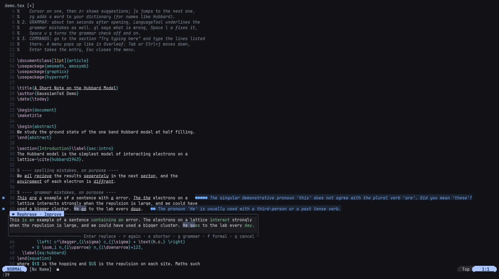
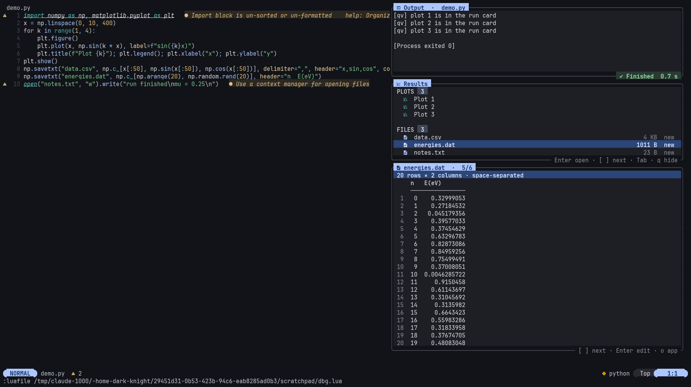
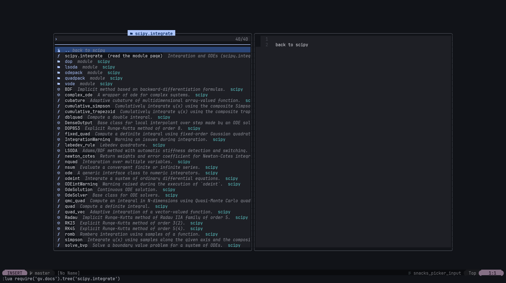
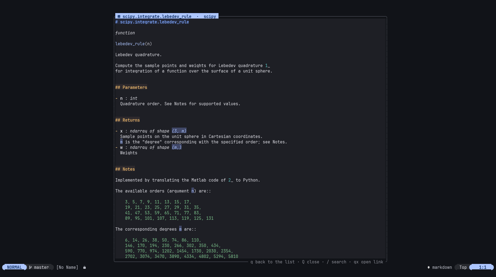

# GaussianVim + GaussianTeX

A light Vim-style editor for physics work (`gv`), and the same editor set up as an
Overleaf-like LaTeX app (`gtex`). Built on Neovim 0.12; installs next to any Vim /
Neovim you already have without touching them.

- **Run code with F5**: output, errors you can jump to, matplotlib plots and data
  files right inside a card (zoom, step through them), stop with Ctrl+C.
- **LaTeX like Overleaf**: projects from templates (Physical Review B,
  arXiv, Nature, notes, book, Beamer; add your own), Compile / PDF buttons, compile on save,
  zathura beside the editor with SyncTeX, spell + grammar checks, the command menu,
  full environment templates, short maths aliases (`//` → `\frac{}{}`, `;a` → `\alpha`),
  figure previews, project files with upload, zip export.
- **Help built in**: offline NumPy / SciPy / Matplotlib / Python / pandas / LaTeX docs,
  Stack Exchange search, Claude Code in a side panel, and a searchable Dictionary of
  every key and alias (Super+?).

## Screenshots

| | |
|---|---|
|  **Dictionary** (Super+?): search in plain words, "make a fraction" finds the aliases |  Instant maths aliases with typeset previews (`;a` → α) |
|  **GaussianTeX** projects (`gtex`): new from a template, open, import .zip, rename |  Choosing a template, with a live preview of its main file |
|  Spelling and grammar marks while you write; `\begin{equation}` completed with its `\end` |  Compile on save: the button turns red with the error count, the line gets a mark |
|  `Space l p`: the paragraph rewritten by the local Qwen, changed words in green |  F5 run card: plots and files the run made; a .dat file shown as a table |
|  Offline docs (`Space s d`): `scipy.integrate` as a tree of its functions |  A formatted docs page: signature, parameters, sections |

*(Plots inside the run card and typeset equations are drawn by kitty and don't show in these terminal captures.)*

## Install (Ubuntu, Debian, Fedora, Arch)

```bash
git clone https://github.com/knight-dwell/gaussianvim ~/gaussianvim
cd ~/gaussianvim && ./install.sh                       # --help for options
```

Then: `gv`, `gtex`, `gv-dict`. **Read [docs/GUIDE.md](docs/GUIDE.md)** (also `:GvGuide`
inside gv): every key, every template, every alias with examples.

## Layout

| In the repo | Installed to |
|---|---|
| `config/` | `~/.config/gaussianvim/` |
| `share/dictionary/`, `share/brand/` | `~/.local/share/gaussianvim/` |
| `bin/` (`gv`, `gtex`, `gv-dict`, `vimhelp`) | `~/.local/bin/` |
| `applications/` | `~/.local/share/applications/` |

`./sync.sh` copies the live files of this machine back into the repo before a commit.

KaTeX (in `share/dictionary/web/katex`) is MIT licensed.
